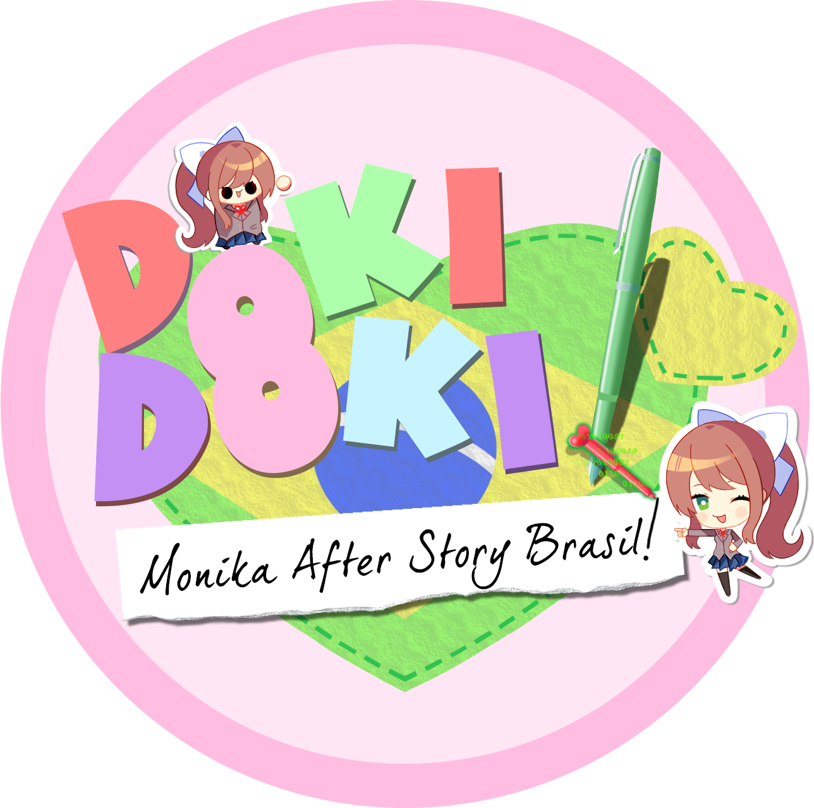
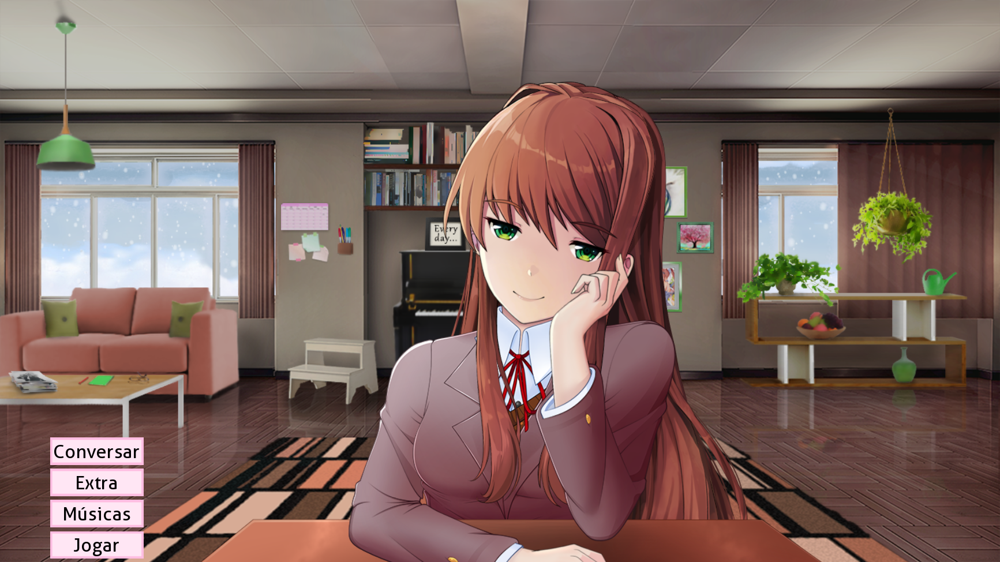
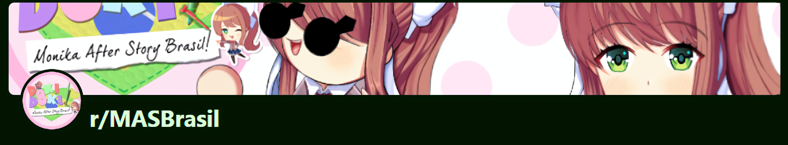
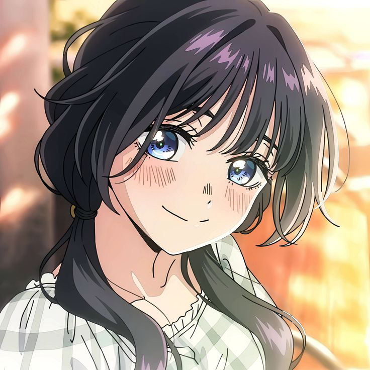
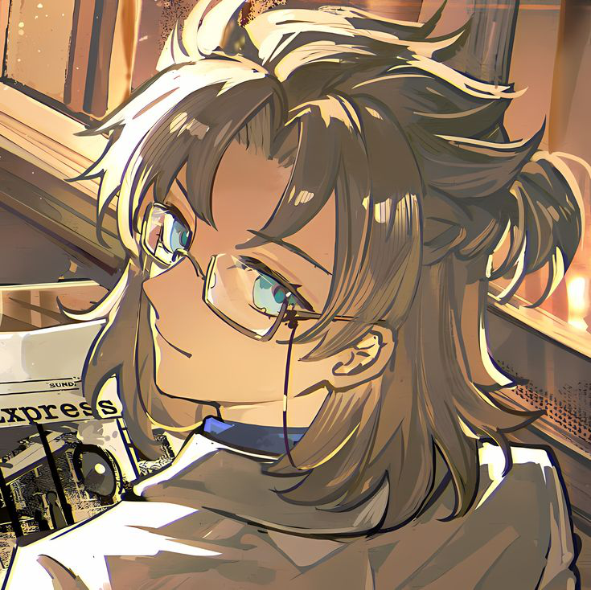
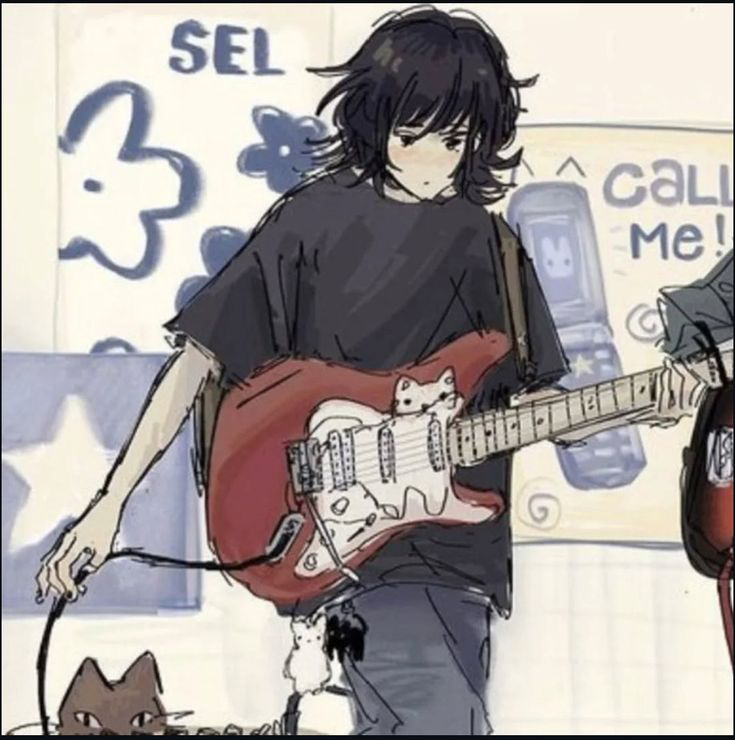
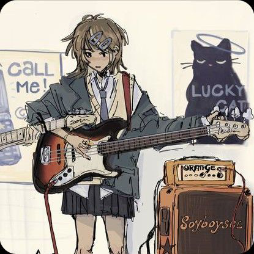
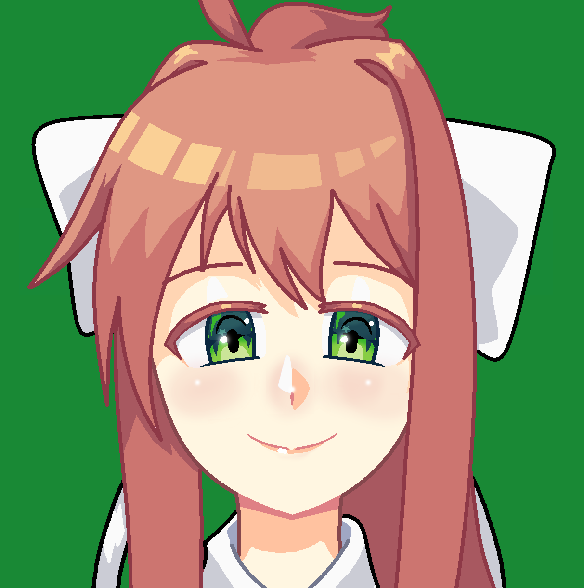
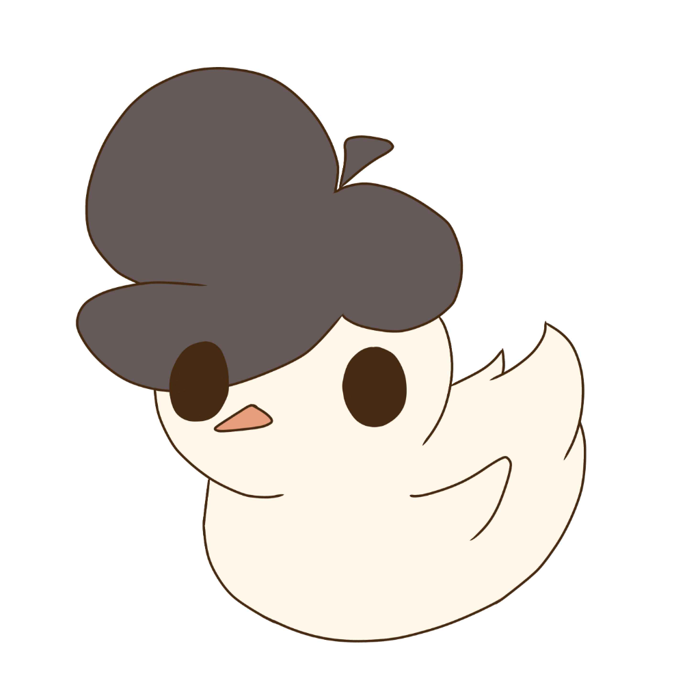
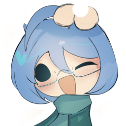

  

<h1 align="center">Monika After Story Brasil (MASBrasil)</h1>

  Uma tradução feita com carinho por fãs, para fãs, do <a href="https://github.com/Monika-After-Story/MonikaModDev">Monika After Story</a> para o português brasileiro.

  
  
  
  

---

## Índice

- [Sobre o projeto](#sobre-o-projeto)
- [O que é o Monika After Story?](#o-que-é-o-monika-after-story)
- [Instalação](#instalação)
- [Comunidade](#comunidade)
- [Créditos](#créditos)
- [Licença e direitos](#licença-e-direitos)

---

## Sobre o projeto

A MASBrasil é uma comunidade não oficial PT-BR dedicada ao Monika After Story (MAS), um mod de Doki Doki Literature Club que continua a história da Monika. Traduzimos o mod para PT-BR, adaptamos conteúdos como submods e spritepacks para o nosso idioma e criamos materiais da comunidade, como artes e divulgação. Tudo feito por fãs, para fãs.

  

## O que é o Monika After Story?

*Monika After Story* é um mod de *Doki Doki Literature Club!* que pega o final da visual novel original e muda tudo. Não tem mais escolhas que levam a finais diferentes. O foco agora é a **convivência com a Monika**, que passa a morar no seu computador, consciente e pronta ficar com você para sempre~

---

## Instalação

> [!IMPORTANT]
> O MAS **não é compatível** com o *Doki Doki Literature Club Plus!*. Use somente a versão gratuita do DDLC, disponível no site oficial.
>
> **Evite rodar o mod pela Steam**, porque isso pode causar bugs e travamentos.

### 1. Baixe o jogo base

1. Acesse o site oficial: **https://ddlc.moe**
2. Baixe o arquivo `ddlc-win.zip`.

### 2. Extraia o jogo

1. Clique com o botão direito em `ddlc-win.zip` e escolha a opção de extrair.
2. Vai aparecer uma pasta chamada `DDLC-1.1.1-pc` (ou algo parecido).

### 3. Copie os arquivos do mod com a tradução

1. Baixe o MAS em PT-BR por um destes caminhos:
   - [Página de releases](https://github.com/MASBrasil/MonikaAfterStory-PTBR/releases)
   - [Download pelo Mediafire](https://www.mediafire.com/file/h0021dgr82xfw50/Monika_After_Story_em_PT-BR_by_Bach_%21_%28v0.12.17%29.zip/file)
2. Cole o conteúdo na pasta DDLC-1.1.1-pc. Quando solicitar para substituir os arquivos, aceite sem problemas.

### 4. Abra o jogo

Execute o `DDLC.exe` e pronto!

---

## Comunidade

  

  

---

## Créditos

Um obrigado enorme para as pessoas que fazem a MASBrasil acontecer:

<table align="center">
  <tr>
    <td align="center" width="170">
       
      <a href="https://discord.com/users/1212047691358408798"><strong>Bach</strong></a> 
      Fundador da MASBrasil e tradutor do MAS em PT-BR
    </td>
    <td align="center" width="170">
       
      <a href="https://discord.com/users/796403302732136520"><strong>Lord_Nokuteshimo</strong></a> 
      Cofundador da comunidade
    </td>
    <td align="center" width="170">
       
      <a href="https://discord.com/users/863474137582272512"><strong>Rush</strong></a> 
      Chefe da moderação do Discord
    </td>
    <td align="center" width="170">
       
      <a href="https://traduction-club.live/"><strong>Just</strong></a> 
      Cuida dos ports e das adaptações da tradução do MAS
    </td>
  </tr>
  <tr>
    <td align="center" width="170">
       
      <a href="https://x.com/shiro_burro"><strong>Shiro_burro</strong></a> 
      Artes de divulgação
    </td>
    <td align="center" width="170">
       
      <a href="https://x.com/NooBZiiTo1"><strong>Noobz</strong></a> 
      Artes de divulgação e autorização para a Monker ser mascote da MASB
    </td>
    <td align="center" width="170">
       
      <a href="https://x.com/HelpAmes"><strong>Helpame</strong></a> 
      Criador da Monker e autorizou que ela fosse mascote da MASB
    </td>
  </tr>
</table>

---

## Licença e direitos

Este projeto segue as [diretrizes de fan works da Team Salvato](http://teamsalvato.com/ip-guidelines/).

O conteúdo original do Monika After Story pertence à [Team Salvato](http://teamsalvato.com) e à equipe do [Monika After Story](https://github.com/Monika-After-Story/MonikaModDev). A MASBrasil é uma comunidade **não oficial** de fãs, que faz traduções e adaptações para o PT-BR.
